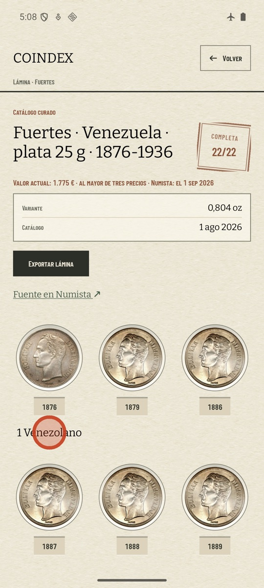
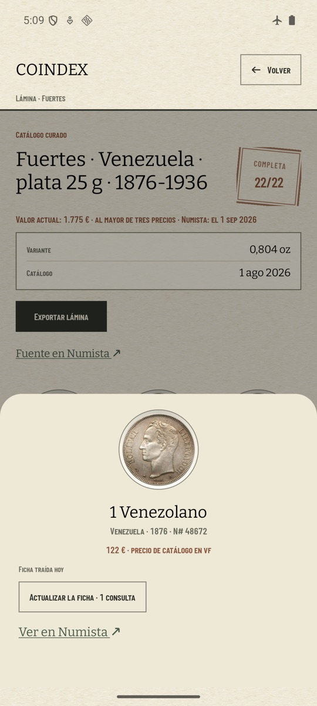
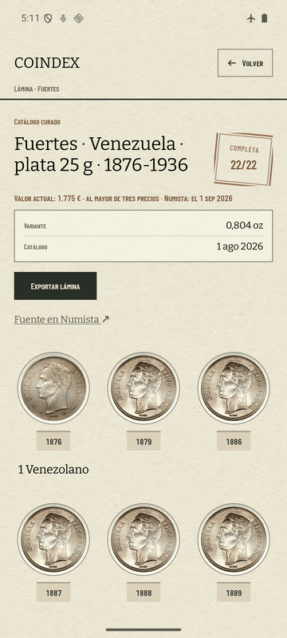
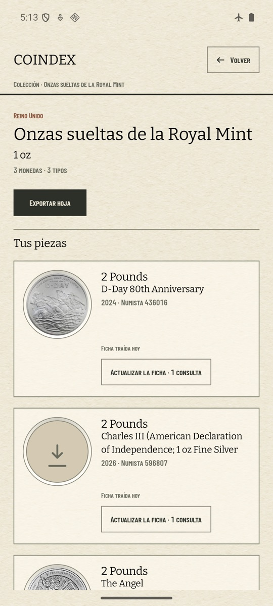
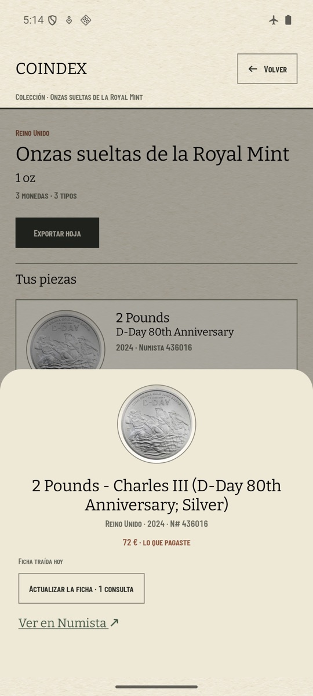

# Toda la casilla abre la ficha (#632)

En `coindex-ux` (pixel 7, 1080 × 2400 a 420 dpi, render por software), con la colección del padre
restaurada (`COINDEX_AVD_VAULT=.local/padre scripts/avd-db.sh restore`) y el modo avión puesto antes
de abrir la app (`ping` a 8.8.8.8: «Network is unreachable»). La misma navegación en las dos
versiones: lámina «Fuertes · Venezuela», y se toca el nombre «1 Venezolano», bajo la casilla de 1876.

| antes (`main`, 1.7.4): no pasa nada | después (esta rama): se abre la ficha |
| --- | --- |
|  |  |

El GIF muestra la rama: se toca el nombre, sube la ficha, se toca el hueco de la ficha y la moneda
gira. Dos montajes:

- **El círculo naranja se dibujó al montar**, centrado en el punto que tocó `adb shell input tap`.
  `show_touches` no pinta los toques inyectados en este AVD.
- La grabación se hizo con `animator_duration_scale` a 5, para tener fotogramas con el render por
  software. Al montar, las dos animaciones (la entrada de la ficha y el giro) volvieron a su
  velocidad real; las pausas son las de la grabación.

## Hojas y cajas

«Onzas sueltas de la Royal Mint», una colección sin lámina:

| la hoja | tocar «D-Day 80th Anniversary» |
| --- | --- |
|  |  |

La tarjeta ya no lleva «Ver en Numista ↗», porque está en la ficha. «Actualizar la ficha» (y
«Quitar de la colección» en una caja) baja debajo de la moneda y no comparte el toque con ella. La
ficha no enlaza de vuelta a la colección desde la que se abrió.

## Lo que no se vio

- **«Lo que busco»**: el padre no tiene ninguna casilla marcada, así que la pantalla no tiene filas
  que tocar. No se marcó ninguna, para no sembrar datos. Lo cubre `WishCellTest`.
- **La cuota**: ninguna llamada llegó a Numista. El `api_call_log` del AVD sí anotó 14 intentos
  (`/oauth_token` y `/types/11156/issues`, en cada arranque), todos con el modo avión puesto. No
  quedó ninguna lectura guardada para el tipo 11156. Pasa igual en `main`: la app anota el
  intento antes de que falle la red.
