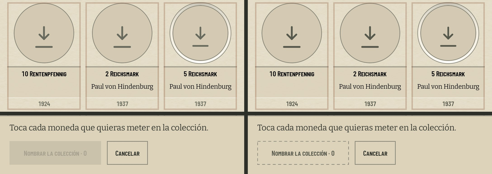
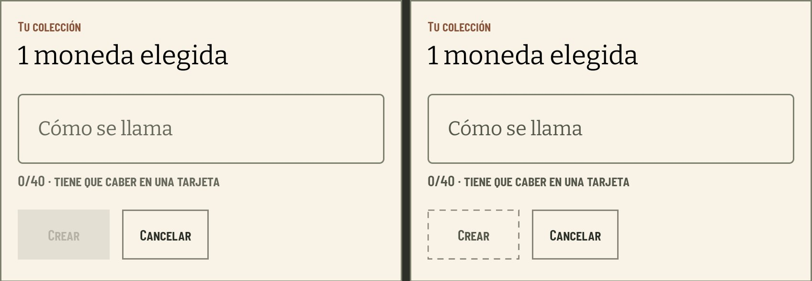
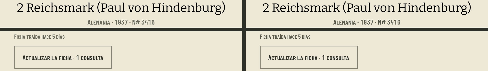
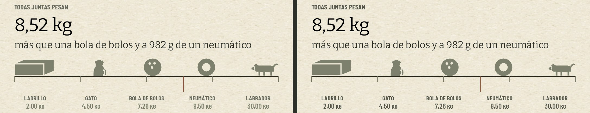
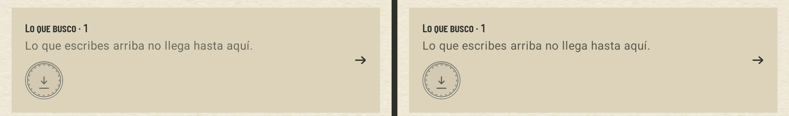
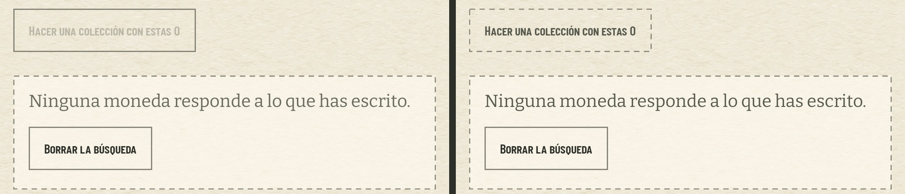
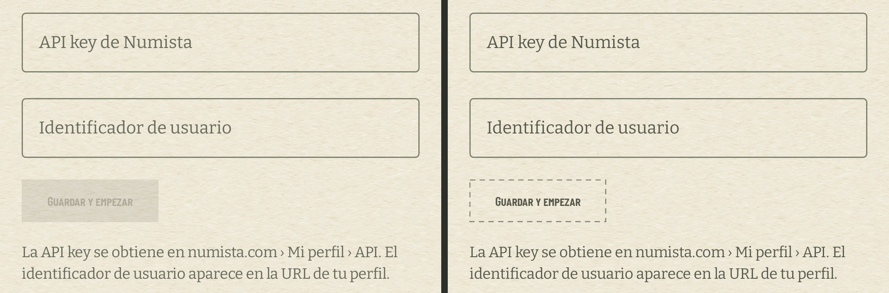
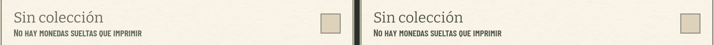
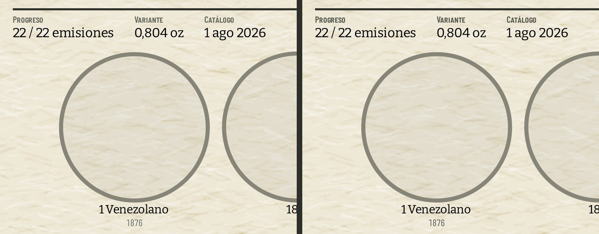

# El gris del texto se lee sobre todos los fondos (#633)

`Paper.muted` pasa de `#686A5D` a `#56584C` y las magnitudes de la escalera de «Las cifras» dejan
`Paper.line` por `muted`. Los botones desactivados dejan el 38 % de Material: van sin relleno, con
la etiqueta en `muted` y una regla discontinua, la marca de la ausencia en `FieldCard`. Una acción
desactivada es una acción ausente. Jose eligió la regla discontinua en la revisión del PR.

## Cómo se midió

AVD `coindex-633` (Pixel 7, 1080 × 2400 a 420 dpi, google_apis, render por software), en modo avión
desde antes de abrir la app por primera vez: cero consultas. La colección es la del padre,
restaurada con `scripts/avd-db.sh restore`; las fotos no están porque el AVD nunca tuvo red. El APK
de antes es `main` (6e3eb81) y el de después, esta rama instalada encima con `adb install -r`, así
que los datos y la navegación son los mismos. Los botones desactivados se recapturaron con la regla
discontinua en la misma sesión y sobre los mismos datos.

Cada contraste sale del PNG nativo a 1080 de `adb exec-out screencap -p`, nunca de una copia
reescalada. En una caja ceñida al texto, el color del texto es la mediana de los píxeles más cerca
del texto que del fondo (más de la mitad del salto de luminancia) y el fondo es la mediana de los
que están a menos del 10 % del salto desde la moda de la caja. Ratio WCAG 2. Las medianas del texto
caen justo en los colores de la paleta (`104,106,93` antes y `86,88,76` después).

Las capturas enteras no se versionan: «Las cifras», la ficha y la lámina enseñan euros. Los
recortes de abajo los dejan fuera de cuadro.

## Lo medido

| texto | pantalla | antes | después |
| --- | --- | ---: | ---: |
| año bajo cada moneda («1924») | Monedas en «Hacer una colección», sobre el velo del modo | 4,06 | 5,34 |
| «Nombrar la colección · 0», desactivado | listón de Monedas, sin ninguna elegida | 1,47 | 4,87 |
| «Crear», desactivado | diálogo de la colección, sin nombre | 1,60 | 6,55 |
| «0/40 · tiene que caber en una tarjeta» | el mismo diálogo | 4,98 | 6,55 |
| «Alemania · 1937 · N# 3416» | ficha de la moneda | 4,51 | 5,93 |
| «Ficha traída hace 5 días» | ficha de la moneda | 4,51 | 5,93 |
| magnitud de la escalera («2,00 kg») | «Las cifras» | 3,32 | 5,93 |
| referente de la escalera («ladrillo») | «Las cifras» | 4,51 | 5,93 |
| «Lo que escribes arriba no llega hasta aquí.» | puerta de «Lo que busco» mientras se busca | 3,71 | 4,87 |
| «Hacer una colección con estas 0», desactivado | Monedas con una búsqueda sin resultados | 1,63 | 5,93 |
| «Guardar y empezar», desactivado | alta, con los campos vacíos | 1,55 | 5,93 |
| «Sin colección», interruptor desactivado | «Cómo se exporta» | 4,98 | 6,55 |
| «Progreso» | cuaderno impreso, PDF rasterizado a 300 dpi | 4,51 | 5,93 |
| «1876», pie de la moneda | cuaderno impreso | 4,01 | 5,08 |

Sin relleno, la etiqueta desactivada se mide contra el fondo que tenga debajo: el listón
(`paperDeep`, 4,87, el peor caso), la tarjeta del diálogo (6,55) o el papel (5,93).

Que la regla sea discontinua se mide igual, sobre el PNG: en la fila superior del borde de cada
botón se cuentan los tramos de regla. En el listón, «Nombrar la colección · 0» da 17 tramos y
«Cancelar», 1, los dos en la misma fila de píxeles (y = 2064). La regla cae sobre la forma visible y
no sobre la diana de 48 dp. En el diálogo, «Crear» da 8 y «Cancelar», 1.

El pie impreso mide menos que la paleta (4,51 y 5,93) porque su trazo fino apenas tiene píxeles
de color pleno a 300 dpi.

La fibra del grano: el 0,1 % más oscuro del papel desnudo es `225,216,187`, y el gris pasa ahí de
3,87 a 5,09. Contra los `227,218,191` del ticket, de 3,95 a 5,20.

## Antes y después

Izquierda, `main`; derecha, esta rama.

Monedas en «Hacer una colección»: el año sobre el velo y el botón desactivado del listón.

El diálogo de la colección con el nombre vacío.

La ficha de la moneda; el precio de catálogo, que va entre las dos tiras, queda fuera.

La escalera de pesos de «Las cifras».

La puerta de «Lo que busco» mientras se busca en Colecciones (una casilla marcada en este AVD).

Monedas con una búsqueda sin resultados.

El alta con los campos vacíos.

El interruptor desactivado de «Cómo se exporta».

El cuaderno exportado de «Fuertes», página 1 a 300 dpi (segunda exportación de cada APK).

## Lo que no se pudo capturar

Sin red no se llega al banner de actualización ni a «Sincronizar», «Instalar» o «Actualizar la
ficha» mientras trabajan, y no se gastó cuota para verlos. Usan el mismo `PrimaryAction`,
`CardAction` y `Paper.muted` que lo medido, y `DisabledActionTest` y `SinglePaletteTest` los cubren.

## Lo que no cambia

Las casillas fuera del modo de marcar (`outsideTheMode`, 45 %) y el fantasma de «Lo busco» (30 %)
siguen apagados a propósito.
