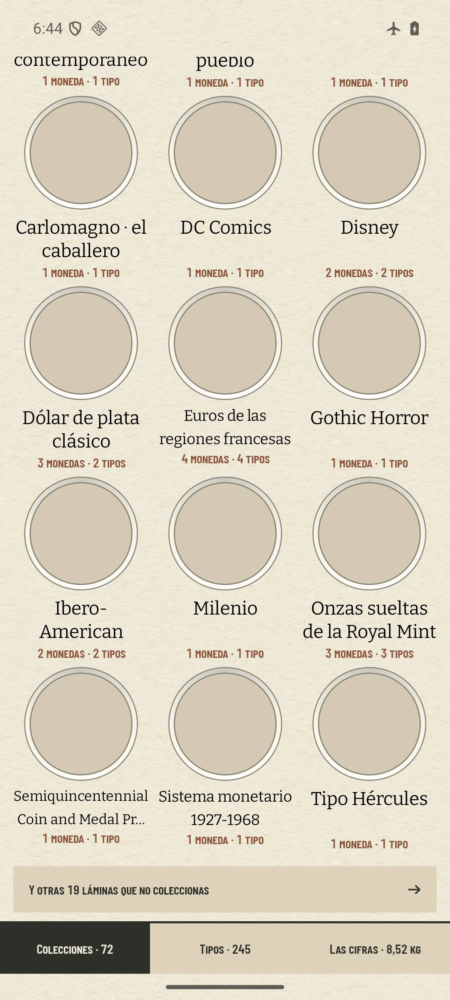
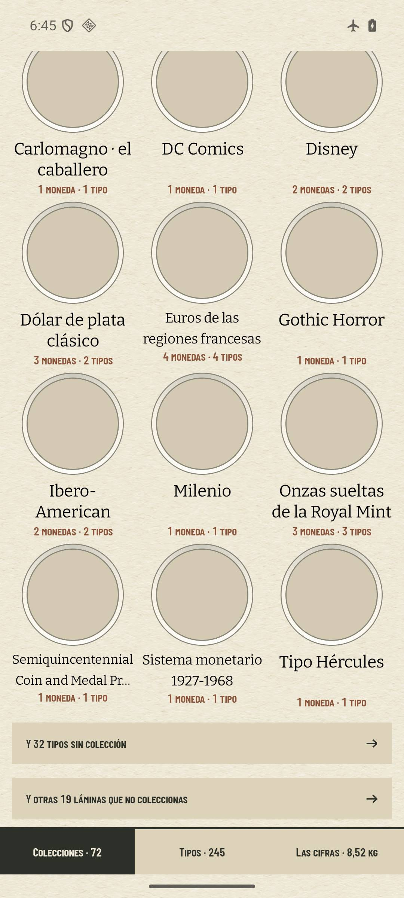
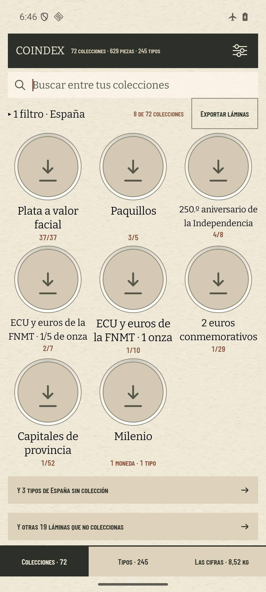
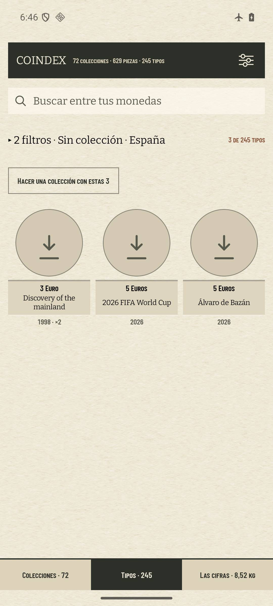
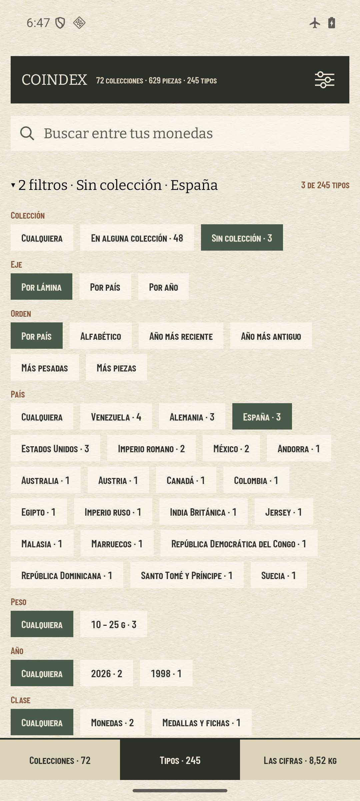
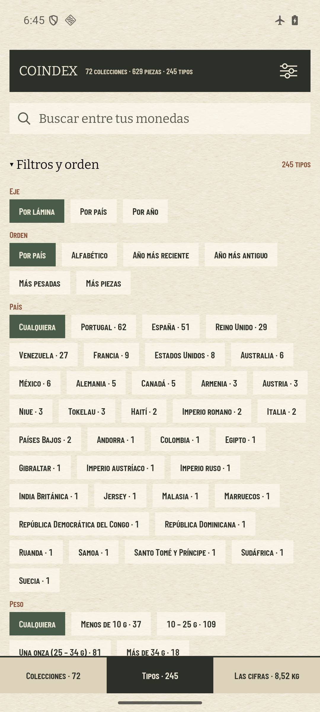

# «Sin colección» a la vista (#634)

Capturas de `coindex-chrome` (pixel 7, 1080 × 2400 a 420 dpi) con la colección del padre restaurada
(`.local/padre/coindex.db`, exportada con la 1.7.3), un alta con credenciales falsas y el modo avión
puesto antes de abrir la app (`ping` a 8.8.8.8: «Network is unreachable»). Las fotos no bajan por eso.
Se instaló primero el APK de `main` y después el de la rama encima, con los mismos datos.

## Colecciones, al pie del eje por lámina

| antes (`main`) | después: sin filtro | después: con «España» |
| --- | --- | --- |
|  |  |  |

La fila nueva va encima de la de «Explorar» y tiene su misma forma. Con un país puesto, la fila se
acota a ese país. A cero no aparece.

## Al tocarla, y el panel de Monedas

| aterriza en Monedas | el panel abierto | antes (`main`) |
| --- | --- | --- |
|  |  |  |

Se aterriza con «2 filtros · Sin colección · España» y «3 de 245 tipos»: el 3 € Descubrimiento (×2),
el 5 € Mundial 2026 y el 5 € Álvaro de Bazán. El chip dice «Sin colección · 3», lo mismo que la
puerta. «Colección» pasa a ser la primera fila del panel, por encima de Eje y Orden, y el resumen
plegado nombra los filtros en ese mismo orden.

## Medido sobre la colección del padre

El informe de campo (`FieldReportTest`) imprime ahora la puerta con y sin país. Con
`COINDEX_FIELD_SNAPSHOT=.local/padre` y `COINDEX_FIELD_TYPES` apuntando a las siete fichas que la
caché sembrada no trae (sacadas de la columna `raw` de `type_meta` de la misma base), da 72
colecciones, 32 tipos sin colección y 3 de España.

Sin esas siete fichas, el informe da 70 colecciones, 34 y 2. Le falta la ficha del 5 € Álvaro de
Bazán, que se queda sin país, y dos familias (5 francs Semeuse y Semiquincentennial) que en el móvil
sí derivan su tarjeta. Las fichas se sacan de la base sin gastar cuota:

    mkdir -p /private/tmp/coindex-privado/padre-types && python3 - <<'EOF'
    import json, sqlite3
    cache = json.load(open('data/numista-type-cache.json'))
    db = sqlite3.connect('file:.local/padre/coindex.db?mode=ro', uri=True)
    for type_id, raw in db.execute('select typeId, raw from type_meta'):
        if str(type_id) not in cache:
            open(f'/private/tmp/coindex-privado/padre-types/type_{type_id}_es.json', 'w').write(raw)
    EOF

## Lo que no se vio

- Un país que sólo tiene monedas sueltas. El chip de país de Colecciones sólo ofrece países con
  alguna tarjeta, así que la puerta acotada llega a 8 de los 21 países con sueltas del padre. Los
  otros 13 (Andorra, Colombia, «Imperio romano»…) se alcanzan con la puerta sin filtro.
- La cuota: ninguna llamada llegó a Numista. El `api_call_log` del AVD anotó tres intentos
  (`/oauth_token` y `/types/11156/issues`), con el modo avión puesto y una clave falsa.
