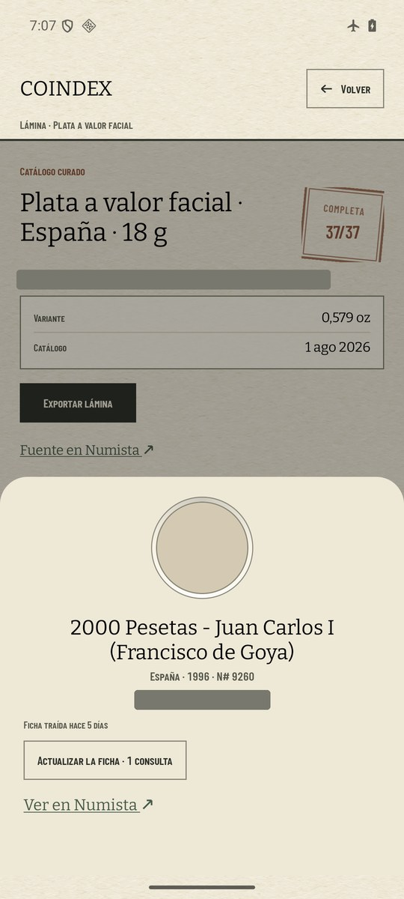
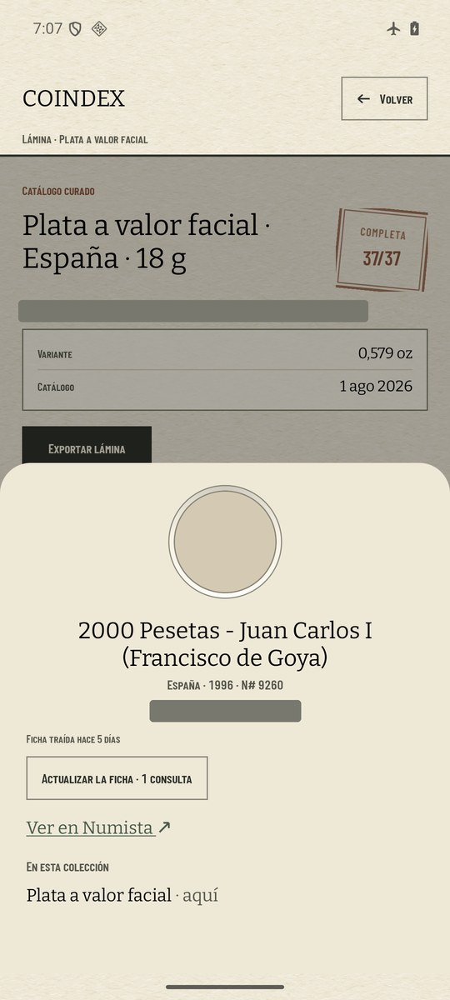
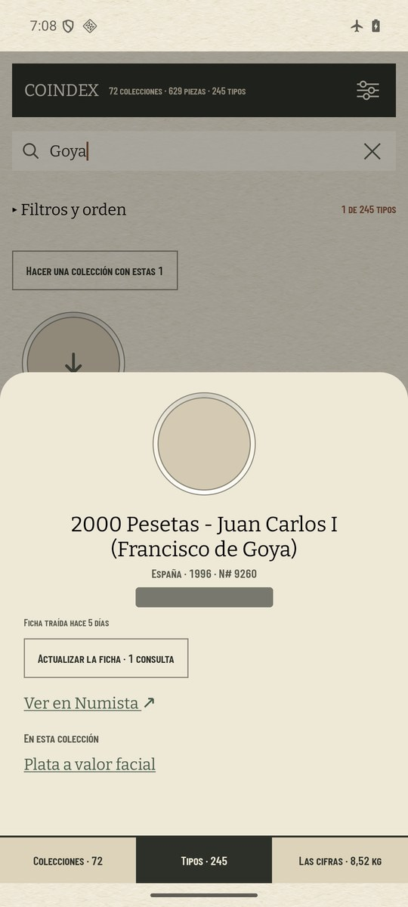

# La ficha nombra todas sus colecciones (#635)

En `coindex-chrome` (pixel 7, 1080 × 2400 a 420 dpi), con la colección del padre restaurada
(`COINDEX_AVD_VAULT=.local/padre scripts/avd-db.sh restore`) y el modo avión puesto antes de abrir la
app (`ping` a 8.8.8.8: «Network is unreachable»). La misma navegación en las dos versiones: lámina
«Plata a valor facial», casilla de 1996, 2000 pesetas · Francisco de Goya.

| antes (`main`): no nombra ninguna colección | después (esta rama): «· aquí», sin enlace |
| --- | --- |
|  |  |

La misma moneda abierta desde Monedas, donde la colección sigue siendo enlace:

El padre no tiene cajas, y ninguna moneda suya la reclaman dos tarjetas del índice (los programas no
son tarjetas). Así que en `main`, abierta desde una lámina, su ficha no nombraba nunca ninguna
colección. El caso de dos colecciones lo cubre `CasillaOpensTheSheetTest`.

## Notas

- **Importes tapados**: el valor de la lámina y el de la moneda llevan una franja gris, porque el repo
  es público.
- **Las fotos** no bajaron con el modo avión. El hueco sale vacío en las dos versiones.
- **La cuota**: ninguna llamada llegó a Numista. El `api_call_log` del AVD anotó 8 intentos
  (`/oauth_token` y `/types/11156/issues`), todos con el modo avión puesto, como en el #632.
