# La ficha de una moneda a pantalla entera (#643)

En `coindex-chrome` (pixel 7, 1080 × 2400 a 420 dpi), con la colección del padre restaurada desde una
copia de `.local/padre/coindex.db` y el alta hecha con credenciales falsas. La red estaba puesta para
que bajaran las fotos: con una clave que no es de nadie, Numista contesta 401 y no gasta cuota. La
misma navegación en `main` y en esta rama.

## Las cinco monedas de la maqueta

**5 bolívares (N#10340), desde la casilla de 1929 de «Fuertes».** Entra con «Tus piezas» abierta y
1929 elegido entre las 21 fechas. Al bajar, la barra compacta guarda la moneda, el título y el valor.

| antes (`main`) | después | después, al bajar |
| --- | --- | --- |
| 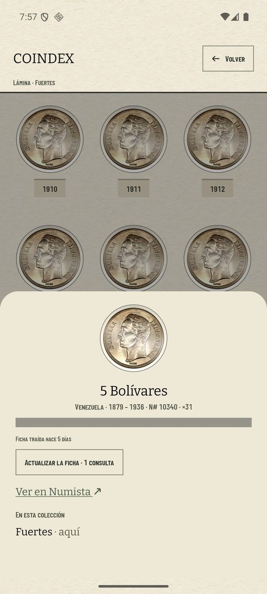 | 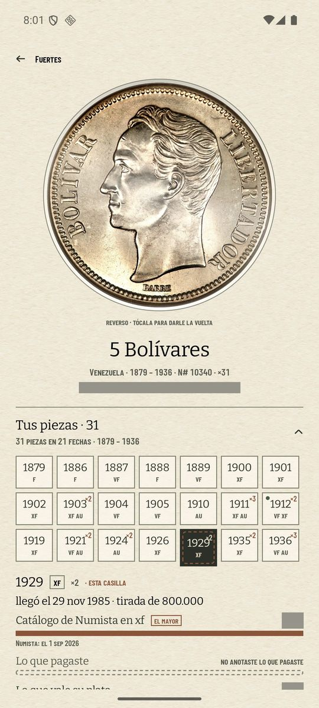 | 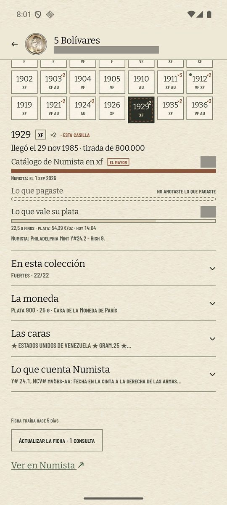 |

**Unicorn of Scotland 2 oz (N#127263), hueco de «The Queen's Beasts».** «Te falta», «Te costaría» y
sus dos peldaños: Numista en `unc` y la plata.

| antes (`main`) | después | «Lo que costaría» |
| --- | --- | --- |
| 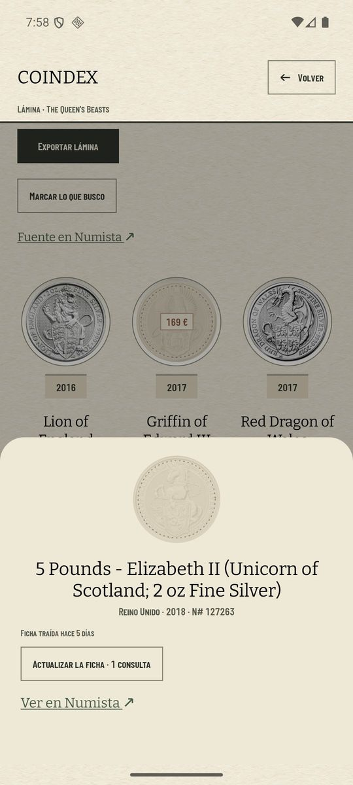 | 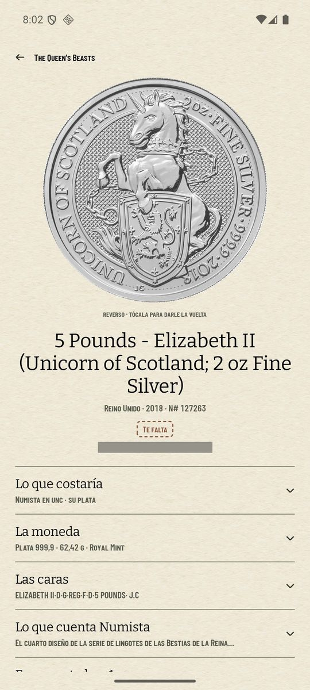 | 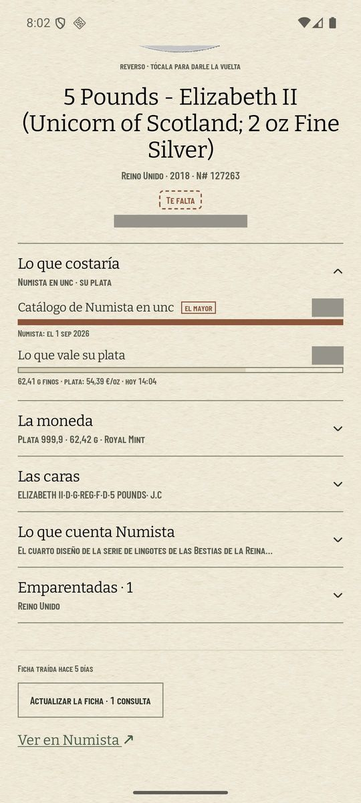 |

**Cuatricentenario de Caracas (N#578835), desde Monedas.** «Volver» dice «Tipos», como la celda de la
barra (#516). Sin cartón, porque no la reclama ninguna colección. La cartela se titula «La medalla».

| la ficha | «La medalla» | «Lo que cuenta Numista» |
| --- | --- | --- |
| 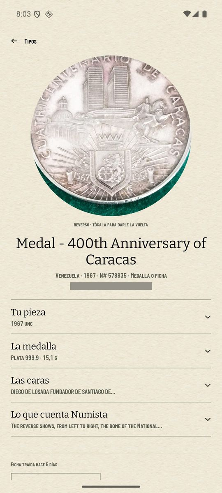 | 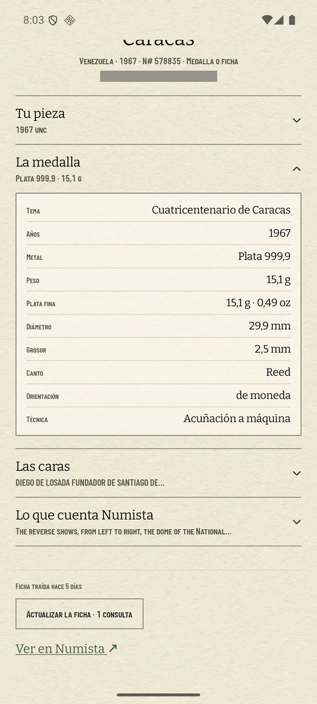 | 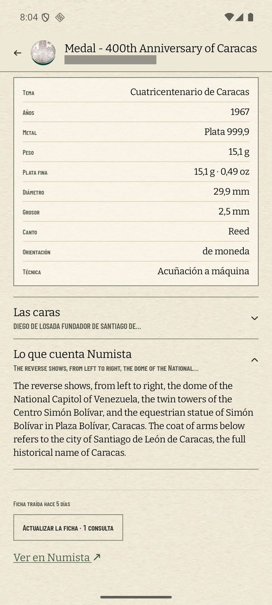 |

**2 euros de la Policía Nacional (N#401375), desde «2 euros conmemorativos».** El canto es texto en
«Las caras». Su `↊` sale como un 2 girado, y «Ver la foto del canto» la abre aparte.

| la ficha | «Las caras» | la foto del canto |
| --- | --- | --- |
| 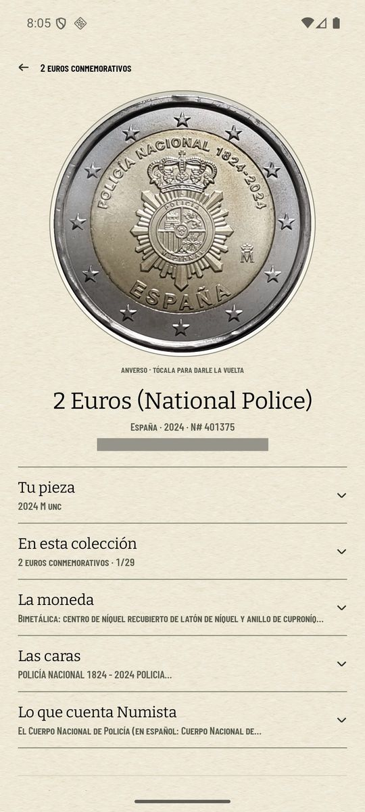 | 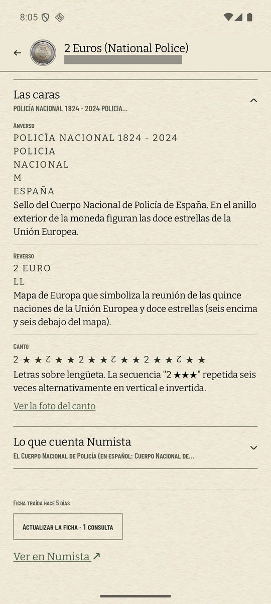 | 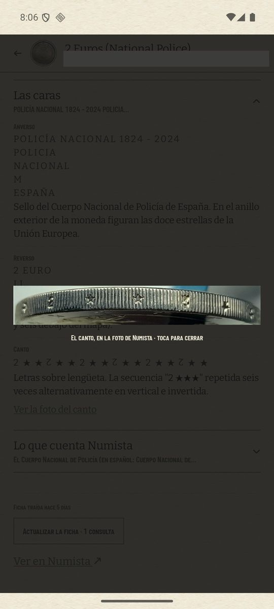 |

**8 reales de Carlos IV (N#18852), desde «Historia del real».** Dos piezas, cada una con sus tres
precios y «el mayor» en lo pagado. La nota privada y la foto propia están tapadas.

| la ficha | «Tus piezas» |
| --- | --- |
| 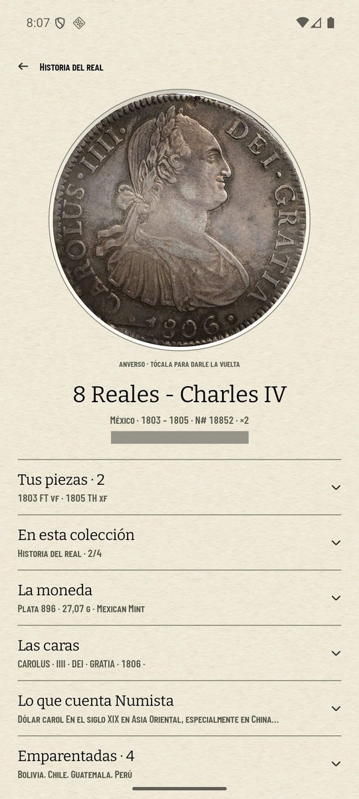 | 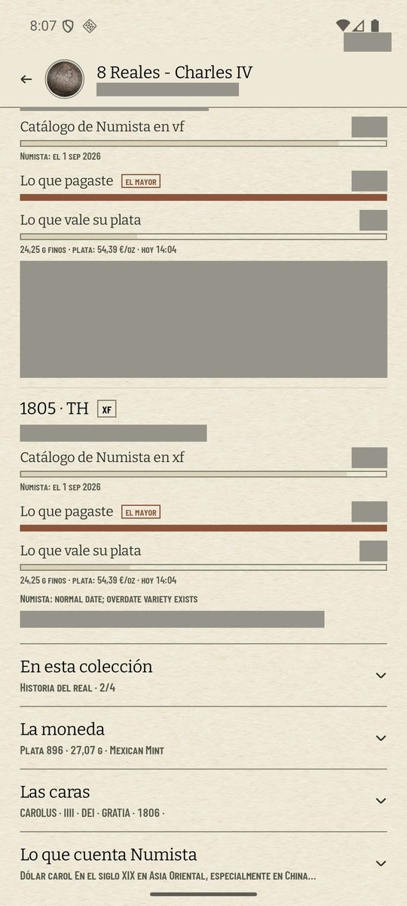 |

## El gesto

De Monedas a la ficha, la moneda vuela a su hueco de 300 dp. Al tocarla gira, y el rótulo pasa de
«reverso» a «anverso». «Atrás» la devuelve a su celda.

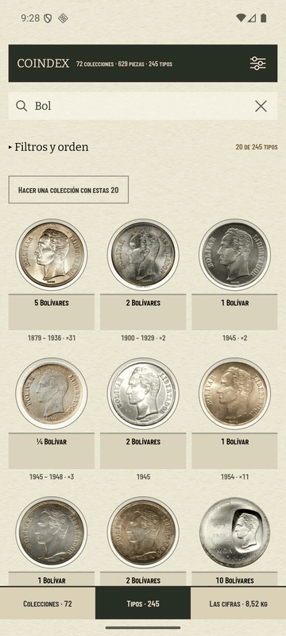

## Los glifos de las leyendas

Se sacaron las 208 fuentes de `/system/fonts` del AVD (android-36) y se cruzó su cobertura, con
`fontTools`, con todos los caracteres de las leyendas y descripciones de los 245 tipos del padre:

| glifo | tipos | ¿lo pinta Android? |
| --- | ---: | --- |
| ★ | 12 | sí |
| ⚜ | 8 | sí |
| ✠ | 4 | sí |
| armenio | 3 | sí |
| árabe (y persa) | 2 | sí |
| chino | 2 | sí |
| cirílico | 2 | sí |
| `↊` (U+218A) | 1 | no: se dibuja girando el 2 |
| `🟌` (U+1F7CC) | 2 | no: se escribe `✶` (U+2736), que sí está en Noto Sans Symbols |

Ni Bitter ni Barlow traen ninguno de ellos; los demás los resuelve la fuente del sistema. El `🟌` lo
llevan la fecha del anverso y el canto de los 100 pesetas de Franco (N#1885) y el N#14673. Sin la
sustitución, salía como una caja vacía.

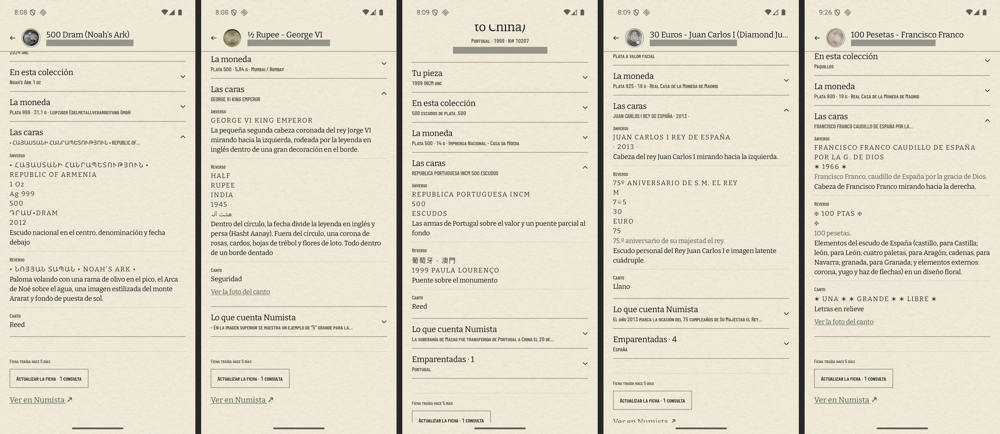

El 100 pesetas de Franco, con la estrella ya sustituida:

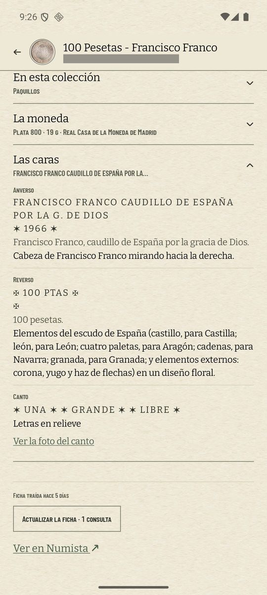

## Notas

- **Importes tapados**: valores, precios, lo pagado, notas privadas y fotos propias llevan una franja
  gris, porque el repo es público. Las capturas sin tapar están en
  `/private/tmp/coindex-privado/ficha-643/`.
- **El hueco no tiene «En esta colección»**, como la hoja de antes: el #635 decidió que a un hueco no
  lo reclama ninguna colección, ni la lámina desde la que se abre. La maqueta sí la enseñaba.
- **«Tipos» y no «Monedas»**: el issue pedía «Monedas», pero la celda que el padre toca dice «Tipos»
  desde el #516.
- **La cartela y las caras llegan un instante después** que la moneda y las piezas, porque se leen
  del cuerpo guardado al abrir la ficha. Durante el vuelo de la moneda no se nota.
- **La moneda grande pide la foto original** a Numista y la pinta encima de la miniatura cuando llega.
  Sin red se queda la miniatura.
